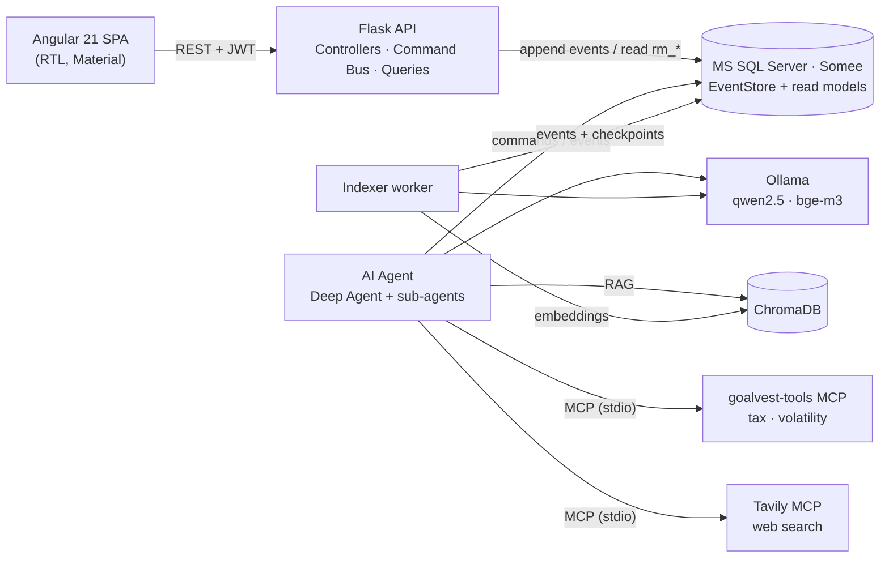
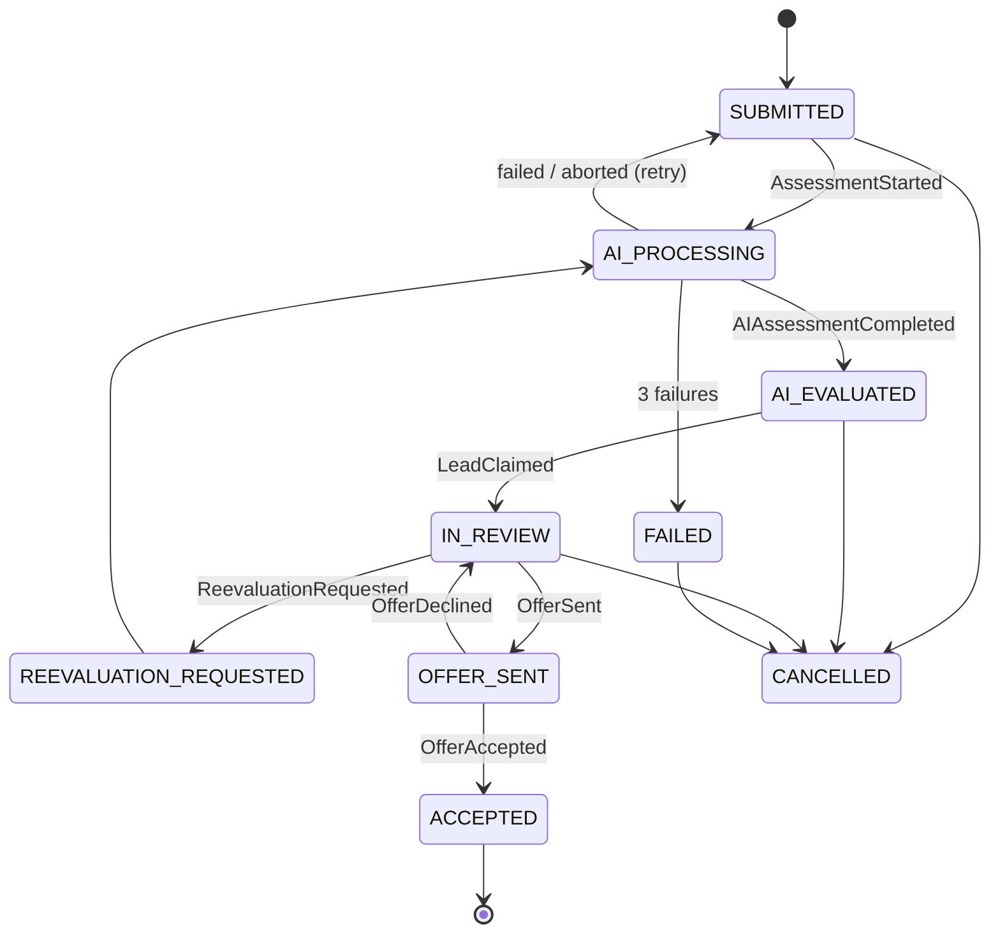

# GoalVest

**Goal-based investment matching with an AI analyst and a human in the loop.**

An investor defines a financial goal (an apartment in five years, a child's education, retirement).
A local AI agent evaluates which investment channels and products fit that goal, explaining *why*
with cited sources. A licensed agent from a matching financial institution reviews the assessment
and sends a concrete offer, which the investor accepts or declines.

Built as the final project of the *Software Engineering in the AI Era* course (Lev Academic Center)
using **Spec-Driven AI Development**: full specifications, rules and skills first, code second.

**Team:** Chedva Sebbag, Ayelet Sorovsky

> The UI is in Hebrew (RTL). The specification under [`docs/`](docs/00-README.md) is in Hebrew;
> code, comments and this README are in English.

---

## Highlights

- **Event Sourcing + CQRS** on MS SQL Server in the cloud: every state change is an immutable event;
  screens read from projected read models.
- **Deep Agent** (LangChain `deepagents`) running on a **local LLM via Ollama**, with two specialised
  sub-agents, a three-level fallback (deep agent → chain → deterministic baseline) and schema validation.
- **RAG** over uploaded policy documents and a knowledge base (ChromaDB + `bge-m3` embeddings).
- **MCP**: our own `goalvest-tools` server (tax calculator, volatility) plus the Tavily web-search MCP server.
- **Privacy by design**: no personal data or amounts ever leave the machine in external searches.
- **Production-grade details**: optimistic concurrency, idempotent commands, JWT with refresh rotation,
  rate limiting, role-based access, health dashboard, guided onboarding.
- **One command** starts the whole system, and one flag gives you a public link to share it.

## Architecture



Three independent processes (API, agent, worker) share one domain package (`core/goalvest_core`) and
write events to the same event store. Long-running AI work never blocks the API.

### Write and read paths

| Step | Write (command) | Read (query) |
|---|---|---|
| Client | `*-commands.service.ts` (POST + `Idempotency-Key`) | `*-queries.service.ts` (GET) |
| API | Blueprint → `CommandBus` → handler | Blueprint → query service |
| Domain | Aggregate checks business rules and records events | — |
| Storage | `EventStore` (INSERT only) + projectors update `rm_*` in the same transaction | `rm_*` read models only |
| Returns | `{id, version}` | view-ready JSON |

### Request lifecycle



## Tech stack

| Layer | Technology |
|---|---|
| Frontend | Angular 21 (standalone components, signals, new control flow), Angular Material, TypeScript |
| API | Python 3.12, Flask 3 (Blueprints), Pydantic, flask-jwt-extended, flask-limiter, SQLAlchemy |
| Database | MS SQL Server 2022 on Somee.com (event store + read models) |
| AI | Ollama (`qwen2.5:7b-instruct` for reasoning, `bge-m3` for embeddings), LangChain `deepagents` |
| Retrieval | ChromaDB (cosine similarity) |
| Tools | Model Context Protocol: FastMCP server, `langchain-mcp-adapters`, Tavily MCP |
| Dev tooling | `dev.sh` one-command runner, Cloudflare quick tunnel, pytest, Vitest (`ng test`), Ruff |

## Getting started

### Prerequisites (once)

- macOS with [Homebrew](https://brew.sh) (the runner script uses macOS commands)
- Python 3.12 and Node.js 20+
- [Ollama](https://ollama.com/download)
- [ODBC Driver 18 for SQL Server](https://learn.microsoft.com/sql/connect/odbc/linux-mac/install-microsoft-odbc-driver-sql-server-macos)
- A SQL Server database (we use a free [Somee.com](https://somee.com) instance)
- Optional: a [Tavily](https://tavily.com) API key for web search

Docker is **not** required: ChromaDB runs straight from the Python environment.
`docker-compose.yml` is kept as an alternative.

### 1. Clone and configure

```bash
git clone https://github.com/ChedvaSebbag/GoalVest.git
cd GoalVest
cp .env.example .env          # fill in DB_*, JWT_SECRET and (optionally) TAVILY_API_KEY
python3.12 -m venv backend/.venv
ollama pull qwen2.5:7b-instruct
ollama pull bge-m3
```

Generate a strong `JWT_SECRET`, for example with `python3 -c "import secrets; print(secrets.token_urlsafe(48))"`.
`.env` is git-ignored and must never be committed.

### 2. Run everything with one command

```bash
bash dev.sh --setup   # first run and after pulling new code
bash dev.sh           # every other time
```

`dev.sh` starts and health-checks every component, then opens http://localhost:4200:

| Component | Port | Log |
|---|---|---|
| ChromaDB | 8000 | `logs/chroma.log` |
| Ollama | 11434 | (system app) |
| Flask API | 5000 | `logs/api.log` |
| AI agent | — | `logs/agent.log` |
| Indexer worker | — | `logs/indexer.log` |
| Angular dev server | 4200 | `logs/web.log` |

`--setup` additionally installs Python and npm dependencies, runs the SQL migrations, rebuilds the
lead read models from events and embeds the knowledge base. **Ctrl+C stops everything.**

### 3. Share a public link (optional)

```bash
bash dev.sh --share   # can be combined: bash dev.sh --setup --share
```

Opens a temporary Cloudflare tunnel and prints a `https://….trycloudflare.com` URL that works from any
device while the script is running. Demo-account shortcuts are hidden on shared links.

### 4. Demo data

```bash
source backend/.venv/bin/activate
cd backend && python -m scripts.seed    # products, demo investors and agents
```

| Role | Email | Password |
|---|---|---|
| Investor | `demo.investor1@goalvest.test` | `Demo1234` |
| Agent (Harel) | `demo.agent.harel@goalvest.test` | `Demo1234` |
| Agent (Clal) | `demo.agent.clal@goalvest.test` | `Demo1234` |
| Agent (Migdal) | `demo.agent.migdal@goalvest.test` | `Demo1234` |

On `localhost` the login screen offers one-click buttons for these accounts.

## Using the app

1. **Investor** registers, completes a risk questionnaire and creates a goal (amount, date, liquidity,
   preferred and excluded channels).
2. **AI agent** picks the request up within ~20 seconds and returns a fit score, an allocation per channel,
   recommended products, risk flags and cited sources (typically 1–3 minutes on a laptop).
3. **Human agent** of a matching institution claims the lead, approves (or asks to re-evaluate) the
   assessment and sends an offer of up to three products with percentages.
4. **Investor** gets a notification and accepts or declines the offer.

Every screen shows where the request stands and who needs to act next. A first-time tour, contextual
help tips and a full help center (`/help`) explain each step. The **system status** page shows the
health of the API, database, LLM and vector store.

## AI agent in detail

| Stage | What happens | Code |
|---|---|---|
| Rules | Deterministic suitability rules from `rules.yaml` and `tax_rules.yaml` | `agent/suitability.py` |
| Scoring | Fit score and allocation are computed in code, not by the model | `agent/scoring.py` |
| Evidence | RAG over policy documents and knowledge base; public web search | `agent/searching.py`, `worker/rag.py` |
| Reasoning | Deep agent with sub-agents `market-researcher` and `policy-analyst` | `agent/deep_runner.py` |
| Validation | Pydantic schema, candidate-only products, sourced claims | `agent/schema.py`, `agent/validate.py` |
| Fallback | Deep agent → chain → deterministic baseline, two attempts each | `agent/pipeline.py`, `agent/baseline.py` |
| Privacy | Names, emails and amounts are blocked from external queries | `agent/privacy.py` |
| Lifecycle | Polling, optimistic locking, retry, release of stuck requests | `agent/loop.py` |

Infrastructure outages (Ollama or ChromaDB down) **abort** an assessment without counting it as a
failure; three genuine failures mark the request `FAILED`, and saving the goal again resubmits it.

## Repository layout

```
frontend/    Angular app – core/ (services, guards, interceptors), features/, shared/
backend/     Flask API – controllers/, commands/, queries/, projections/, auth/, infrastructure/
core/        goalvest_core – aggregates, events and business rules shared by all processes
agent/       AI assessment agent (python -m agent)
worker/      document extraction, chunking, embeddings, indexer (python -m worker.indexer)
mcp_tools/   goalvest-tools MCP server (python -m mcp_tools.server)
db/          SQL migrations for MS SQL Server
seed/        knowledge-base documents for RAG
docs/        full specification (Hebrew)
.claude/     rules and skills for the coding agent (also mirrored in .cursor/)
dev.sh       one-command runner
```

## Testing

```bash
cd backend && source .venv/bin/activate && pytest     # in-memory SQLite, no cloud DB needed
cd frontend && npx ng test --watch=false              # Vitest
```

Inspect the MCP server interactively:

```bash
source backend/.venv/bin/activate
npx @modelcontextprotocol/inspector python -m mcp_tools.server
```

Run a single assessment with step-by-step output:

```bash
python -m agent --once --request <request-id> --verbose
```

## Spec-Driven AI Development

The project was built with coding agents guided by documents rather than ad-hoc prompts:

- **Specification** – vision, requirements, architecture, data model, API, AI agent, RAG, security and
  testing plan in [`docs/`](docs/00-README.md), plus a [code tour](docs/19-code-tour.md).
- **Rules** – always-on constraints for the coding agent: architecture (append-only events, thin
  controllers), Hebrew RTL UI, financial compliance (`.claude/rules/`).
- **Skills** – on-demand know-how: our own `add-cqrs-feature` (event → command → projection → query →
  API → screen → tests) and the official `angular-developer` skill from [skills.sh](https://skills.sh).
- **Agent instructions** – [`CLAUDE.md`](CLAUDE.md) and [`AGENTS.md`](AGENTS.md).

## Key design decisions

| Decision | Why | Trade-off |
|---|---|---|
| Event Sourcing | Full audit trail, rebuildable read models, nothing is overwritten | More code than CRUD |
| Synchronous projections | Screens are consistent immediately after a command | Slower writes; a failing projector rolls back the command |
| Optimistic concurrency | Conflicts are rare; no locks | The losing writer gets HTTP 409 |
| Local LLM (Ollama) | Financial data stays on the machine; no API cost | Smaller model, slower; mitigated by validation and fallbacks |
| Score computed in code | Deterministic, explainable numbers | The model only explains and selects |
| MCP for tools | Standard protocol, reusable by any agent, process isolation | Extra process and transport overhead |
| Decimal for money | No floating-point rounding errors | — |

## Known limitations

- The Gmail MCP integration from the specification is not implemented; notifications are shown in-app.
- CI (GitHub Actions) is not configured; tests run locally.
- `dev.sh` targets macOS. On other systems, start the components listed above manually.
- Some networks block outbound SQL Server traffic (port 1433) to Somee.

---

*Assessments are generated automatically and do not constitute investment advice.*
