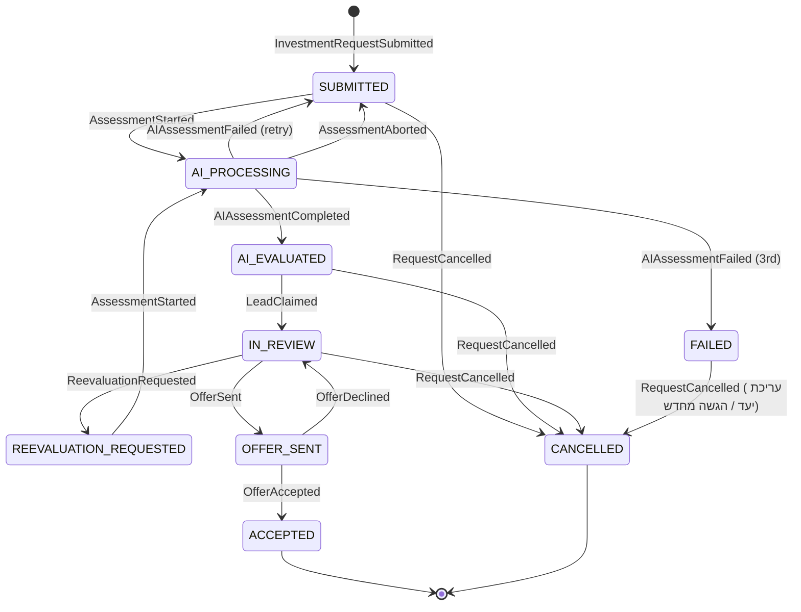

# 03 – דרישות פונקציונליות

## 3.1 מיפוי לדרישות המרצה

| דרישת מרצה | מימוש ב-GoalVest | דרישות |
|---|---|---|
| 1. בחירת נושא | השקעות מבוססות-מטרות | – |
| 2. ניהול משתמשים ואוטנטיקציה | הרשמה, התחברות JWT, שחזור סיסמה | FR-01 – FR-05 |
| 3. שני סוגי משתמשים לפחות | משקיע וסוכן (ומנהל לתחזוקה) | FR-01, 02-users-and-roles.md |
| 4.1 חיפוש נתונים | חיפוש מוצרים במאגר (טקסט חופשי + סינון) | FR-20 – FR-22 |
| 4.2 הצגת פרטים לאחת התשובות | מסך פרטי מוצר ומסך פרטי בקשה/ליד | FR-24, FR-43 |
| 4.3 הצגת נתונים בטבלה | טבלת השוואת מוצרים, טבלת לידים, טבלת תיק | FR-23, FR-40, FR-60 |
| 4.4 דשבורד: סטטוס משרות פתוחות ומספר נרשמים | דשבורד סוכן: לידים פתוחים לפי סטטוס ומספר מתעניינים לכל מוצר/מסלול | FR-41, FR-42 |
| 4.5 הזנת נתונים | אשף יעדים, הגשת בקשת השקעה, הזנת מוצר, העלאת מסמך | FR-10 – FR-14, FR-30 – FR-32 |
| 5. סוכן AI ב-Process עצמאי | Investment Fit Agent | FR-50 – FR-56 |
| דוגמה: איש HR מקבל/דוחה הערכת AI | סוכן מאשר/דוחה הערכת AI | FR-44 |

ההקבלה לדוגמת המרצה: **משרה ↔ מוצר/מסלול**, **מועמד ↔ משקיע**, **בקשה למשרה ↔ בקשת השקעה**, **קורות חיים ↔ פרופיל משקיע + מסמכי פוליסה**, **איש HR ↔ סוכן**.

## 3.2 מודול אוטנטיקציה וניהול משתמשים

| מזהה | דרישה | עדיפות |
|---|---|---|
| FR-01 | הרשמה עם שם מלא, אימייל, טלפון, סיסמה ובחירת סוג משתמש (משקיע / סוכן). סוכן בוחר גוף פיננסי מרשימה ומזין מספר רישיון | Must |
| FR-02 | התחברות עם אימייל וסיסמה, קבלת Access Token ו-Refresh Token | Must |
| FR-03 | התנתקות ופסילת ה-Refresh Token | Must |
| FR-04 | שחזור סיסמה: שליחת קישור חד-פעמי (תוקף 30 דקות) למייל דרך Gmail MCP | Should |
| FR-05 | ניתוב אוטומטי אחרי התחברות לפי תפקיד: משקיע → דשבורד משקיע, סוכן → דשבורד סוכן | Must |
| FR-06 | סוכן חדש בסטטוס "ממתין לאישור" עד אישור Admin. עד אז רואה רק את הקטלוג | Should |
| FR-07 | עריכת פרופיל אישי ושינוי סיסמה | Could |

## 3.3 מודול יעדים ופרופיל משקיע (הזנת נתונים)

| מזהה | דרישה | עדיפות |
|---|---|---|
| FR-10 | שאלון סיכון של 6–8 שאלות (גיל, טווח, תגובה לירידה של 20%, ניסיון, יציבות הכנסה, קרן חירום קיימת). חישוב ציון 1–5: סולידי, סולידי-מאוזן, מאוזן, מאוזן-צמיחה, צמיחה | Must |
| FR-11 | אשף יעד ב-4 שלבים: (1) סוג יעד, (2) סכום התחלתי, הפקדה חודשית וסכום יעד, (3) מועד יעד וגמישות, (4) העדפות: נזילות, אפיקים מועדפים או לא רצויים, גופים מועדפים | Must |
| FR-12 | ולידציה: סכום התחלתי ≥ 0, הפקדה חודשית ≥ 0, לפחות אחד מהם > 0. מועד יעד בעתיד (לפחות 6 חודשים). סכום יעד > 0 | Must |
| FR-13 | תצוגת "בדיקת היתכנות" מיידית באשף: חישוב תחזית צמיחה בשלושה תרחישים (שמרני / צפוי / אופטימי) באמצעות ה-Tool `project_goal_growth`, והאם היעד צפוי להיות מושג | Should |
| FR-14 | הגשת בקשת השקעה מתוך יעד: אישור שיתוף פרטים עם סוכנים (checkbox), אישור הבהרה משפטית. הבקשה נוצרת בסטטוס `SUBMITTED` | Must |
| FR-15 | עריכת יעד או ארכובו. עריכה של יעד עם בקשה פעילה תיצור בקשה חדשה ותסגור את הקודמת | Should |
| FR-16 | למשקיע יכולים להיות כמה יעדים, ולכל יעד לכל היותר בקשה פעילה אחת | Must |

## 3.4 מודול קטלוג מוצרים (חיפוש, טבלה, פרטים)

| מזהה | דרישה | עדיפות |
|---|---|---|
| FR-20 | חיפוש טקסט חופשי לפי שם מוצר, גוף מנהל, מסלול או סימול מנייה | Must |
| FR-21 | סינון לפי: סוג אפיק, רמת סיכון, דמי ניהול מקסימליים, תשואה מינימלית ל-3 שנים, נזילות, גוף מנהל | Must |
| FR-22 | חיפוש סמנטי (Could): שאלה בשפה חופשית ("מסלול סולידי בלי מניות לפרישה") → חיפוש ב-ChromaDB על תיאורי מוצרים ומסמכים | Could |
| FR-23 | טבלת השוואה: עמודות סוג, שם, גוף, מסלול, תשואה 1/3/5 שנים, דמי ניהול מצבירה ומהפקדה, סטיית תקן, נזילות, רמת סיכון. מיון בכל עמודה, עימוד (20 בעמוד), בחירת עד 4 מוצרים ל"השוואה צמודה" | Must |
| FR-24 | מסך פרטי מוצר: כל השדות, גרף תשואות היסטוריות, תנאי נזילות ומיסוי, מסמכי פוליסה להורדה, סוכנים מהגוף, ואם קיימת – הערכת ה-AI להתאמת המוצר ליעדים של המשקיע המחובר | Must |
| FR-25 | עבור מניות ותעודות סל: מחיר עדכני ותנודתיות (שליפה דרך yfinance, Cache של 15 דקות) | Should |
| FR-26 | "הוסף לתיק" ממסך פרטי מנייה | Should |

## 3.5 מודול ניהול מוצרים ומסמכים (סוכן)

| מזהה | דרישה | עדיפות |
|---|---|---|
| FR-30 | סוכן יוצר או מעדכן מוצר של הגוף שלו: סוג, שם, מסלול, דמי ניהול, תשואות, רמת סיכון, תנאי נזילות, הפקדה מינימלית, תיאור | Must |
| FR-31 | העלאת מסמך PDF/DOCX (עד 10MB) למוצר, עם סוג מסמך: תנאי פוליסה, דוח רבעוני, כללי מס, דוח שוק | Must |
| FR-32 | אחרי העלאה המסמך מקבל סטטוס `PENDING_INDEX`. Worker מפרק אותו ל-chunks, מטמיע ב-ChromaDB ומעדכן ל-`INDEXED` (או `FAILED` עם סיבה) | Must |
| FR-33 | סוכן יכול להשבית מוצר. מוצר מושבת לא מוצע בהערכות חדשות | Should |

## 3.6 מודול דשבורד סוכן ולידים

| מזהה | דרישה | עדיפות |
|---|---|---|
| FR-40 | טבלת לידים: שם משקיע (או "משקיע אנונימי" אם לא אישר שיתוף), יעד, סכום, טווח, פרופיל סיכון, ציון התאמה של AI, סטטוס, תאריך. סינון לפי סטטוס וציון, מיון | Must |
| FR-41 | כרטיסי KPI: מספר לידים פתוחים לפי סטטוס (`AI_EVALUATED`, `IN_REVIEW`, `OFFER_SENT`), שיעור המרה (הצעות שהתקבלו / נשלחו), ממוצע ציון התאמה | Must |
| FR-42 | גרף/טבלה "מתעניינים לפי מוצר": לכל מוצר של הגוף – כמה בקשות AI המליץ עליו, כמה הצעות נשלחו, כמה התקבלו | Must |
| FR-43 | מסך פרטי ליד: פרטי המשקיע והיעד, הערכת AI מלאה (ציונים לכל אפיק, תמהיל, נימוק, דגלי סיכון, מקורות RAG ו-Web עם קישורים), ציר זמן אירועים | Must |
| FR-44 | הסוכן לוקח ליד (Claim), ואז מאשר או דוחה את הערכת ה-AI עם הערה חובה בדחייה. ניתן לבקש הערכה מחדש (Re-evaluate) | Must |
| FR-45 | שליחת הצעה: בחירת 1–3 מוצרים של הגוף, תמהיל באחוזים (סכום 100%), הודעה אישית. המשקיע מקבל התראה במערכת ובמייל | Must |
| FR-46 | עדכון בזמן קרוב לאמת: ליד חדש מופיע בדשבורד בלי רענון (Polling כל 15 שניות דרך RxJS) | Should |

## 3.7 מודול דשבורד משקיע, הצעות ותיק

| מזהה | דרישה | עדיפות |
|---|---|---|
| FR-60 | דשבורד משקיע: כרטיס לכל יעד עם התקדמות, סטטוס הבקשה, גרף התפלגות תמהיל מומלץ (דונאט), וטבלת "המסלולים המומלצים עבורך" | Must |
| FR-61 | רשימת הצעות מסוכנים, מסך פרטי הצעה, קבלה או דחייה. קבלה סוגרת את הבקשה ומעבירה את הליד ל-`ACCEPTED` | Must |
| FR-62 | תיק מניות: הוספת מנייה/תעודת סל (סימול, כמות, מחיר קנייה), טבלה עם שווי נוכחי ורווח/הפסד | Should |
| FR-63 | התראות: Job כל 30 דקות בשעות מסחר בודק שינוי יומי בתיק. שינוי מעל סף (ברירת מחדל 5%, ניתן להגדרה) → אירוע `PriceAlertTriggered` ומייל דרך Gmail MCP | Should |
| FR-64 | מרכז התראות במערכת (פעמון) עם מונה הודעות שלא נקראו | Should |
| FR-65 | מסך היסטוריה לבקשה: כל האירועים בסדר כרונולוגי (מימוש גלוי של Event Sourcing) | Must |

## 3.8 סוכן ה-AI (Process עצמאי)

| מזהה | דרישה | עדיפות |
|---|---|---|
| FR-50 | ה-Process רץ בנפרד משרת Flask, ושולף כל 20 שניות בקשות בסטטוס `SUBMITTED` (או `REEVALUATION_REQUESTED`) | Must |
| FR-51 | נעילה אופטימית: לפני עיבוד, הסוכן כותב `AssessmentStarted` עם בדיקת גרסה. אם הגרסה השתנתה – מדלג (מונע עיבוד כפול) | Must |
| FR-52 | סדרת בדיקות: (1) בדיקות כללים דטרמיניסטיות, (2) חיפוש RAG במסמכים, (3) חיפוש Web דרך Tavily MCP, (4) Tools מותאמים: מחשבון מס, תנודתיות, תחזית צמיחה, (5) סינתזה | Must |
| FR-53 | פלט מובנה (JSON לפי סכמה): ציון 0–100 לכל אפיק, תמהיל מומלץ, עד 5 מוצרים מומלצים, נימוק בעברית, דגלי סיכון, מקורות | Must |
| FR-54 | פלט שלא עובר ולידציה → ניסיון חוזר עד 2 פעמים, ואז `AIAssessmentFailed` עם סיבה. הבקשה חוזרת לתור אחרי 10 דקות, עד 3 ניסיונות | Must |
| FR-55 | בסיום: אירוע `AIAssessmentCompleted`, הבקשה עוברת ל-`AI_EVALUATED` ונשלח מייל למשקיע | Must |
| FR-56 | הסוכן מוסיף תמיד הבהרה שאין מדובר בייעוץ השקעות (Rule R3) | Must |

## 3.9 מכונת מצבים – בקשת השקעה

אישור או דחייה של הערכת ה-AI (FR-44) הם אירועים נפרדים (`AssessmentApproved` / `AssessmentRejected`) שלא משנים את הסטטוס הראשי. הם מתועדים ומשפיעים על התצוגה למשקיע ועל מדדי איכות ה-AI.

`AssessmentAborted` מחזיר את הבקשה מ-`AI_PROCESSING` ל-`SUBMITTED` כשתשתית ההערכה לא זמינה (Ollama, Chroma או Tavily). ה-payload כולל `reason` ו-`attempt_not_counted: true`. האירוע לא נספר מתוך שלושת הניסיונות, ולא נכתב `AIAssessmentFailed`.

בקשה במצב `FAILED` אפשר לבטל. כשהמשקיע שומר את היעד (גם בלי שינוי בשדות) הבקשה שנכשלה מבוטלת ונפתחת בקשה חדשה ב-`SUBMITTED`.

## 3.10 User Stories נבחרים עם קריטריוני קבלה

**US-01 – הרשמת משקיע**
כמשקיעה, אני רוצה להירשם עם אימייל וסיסמה כדי לשמור את היעדים שלי.
- בהינתן אימייל שלא קיים וסיסמה של 8+ תווים עם אות ומספר, כשאני לוחצת "הרשמה", אז נוצר משתמש, נשמר אירוע `UserRegistered`, ואני מועברת לשאלון הסיכון.
- בהינתן אימייל קיים, אז מוצגת הודעה "האימייל כבר רשום" ולא נוצר אירוע.

**US-02 – הגדרת יעד דירה**
כמשקיעה, אני רוצה להגדיר יעד "דירה" של 400,000 ₪ בעוד 4 שנים כדי לקבל המלצה.
- בהינתן סכום התחלתי 150,000 והפקדה חודשית 3,000, כשאני מסיימת את האשף, אז מוצגת תחזית ב-3 תרחישים ונשמר `GoalCreated`.

**US-03 – הערכת AI**
כמשקיעה, אחרי הגשת בקשה, אני רוצה לקבל הערכה תוך כמה דקות.
- בהינתן בקשה בסטטוס `SUBMITTED`, כשסוכן ה-AI רץ, אז תוך 3 דקות נוצר `AIAssessmentCompleted` עם ציונים לשלושת האפיקים, ולפחות מקור אחד מ-RAG ואחד מ-Web.
- בהינתן יעד של 4 שנים, אז ציון קרן ההשתלמות לא יעלה על 40 ויופיע דגל "נעילה ל-6 שנים" (אלא אם למשקיע יש קרן ותיקה שמשתחררת לפני היעד).

**US-04 – סוכן דוחה הערכה**
כסוכנת, אני רוצה לדחות הערכת AI שגויה עם הסבר.
- בהינתן ליד ב-`IN_REVIEW` שלקחתי, כשאני לוחצת "דחה הערכה" בלי הערה, אז הכפתור מושבת. עם הערה – נשמר `AssessmentRejected` והליד מציג תגית "הערכה נדחתה".

**US-05 – דשבורד מתעניינים**
כסוכנת, אני רוצה לראות כמה משקיעים מתעניינים בכל מסלול של החברה שלי.
- בהינתן 3 בקשות שבהן AI המליץ על "השתלמות מחקה S&P500", אז בטבלת "מתעניינים לפי מוצר" יופיע 3 בעמודת "הומלץ".

**US-06 – התראת תנודה**
כמשקיע, אני רוצה לקבל מייל כשמנייה בתיק שלי זזה ביותר מ-5% ביום.
- בהינתן מנייה בתיק ששינויה היומי ‎-6.2%, כשה-Job רץ, אז נשמר `PriceAlertTriggered` ונשלח מייל אחד בלבד לאותו יום ולאותה מנייה.
