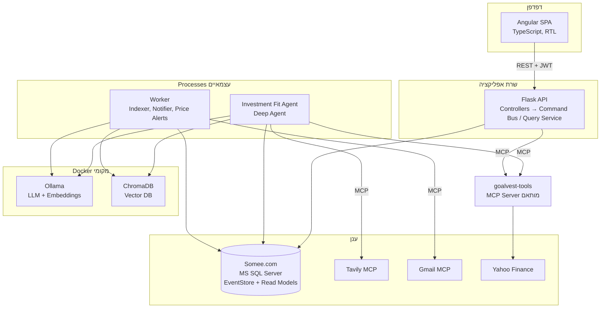
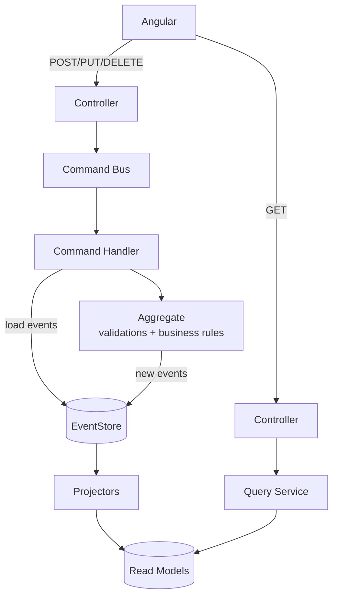
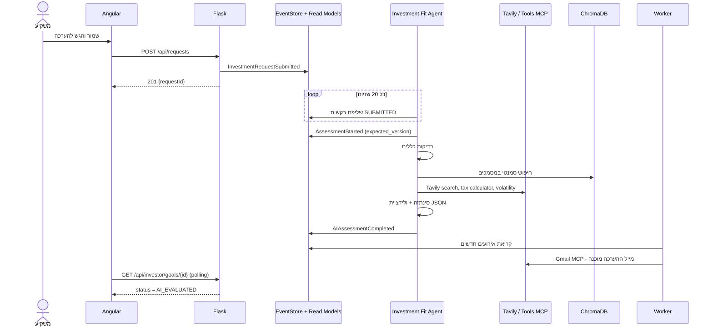
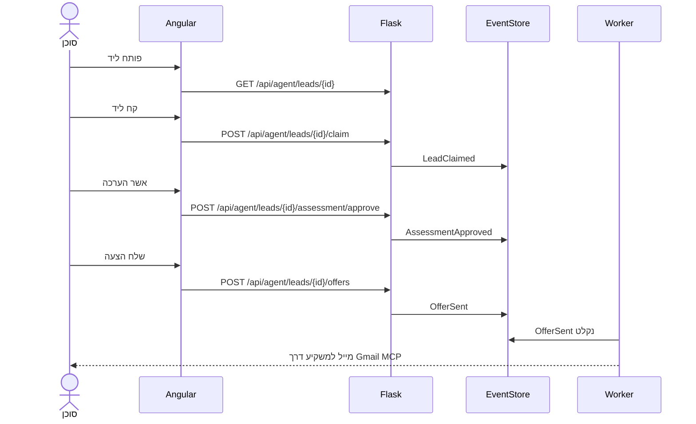

# 06 – ארכיטקטורה

## 6.1 תמונת על



התרשים תואם ל"תרשים 1: מרכיבי מערכת" של המרצה: ה-Resume Info System הוא שרת Flask עם API Gateway, Job Fit Assessment Agent הוא Investment Fit Agent שרץ עם Ollama + Docker, מסד הנתונים ב-Somee, ושירותים חיצוניים (Gmail, Tavily) ו-Tools מחוברים ב-MCP.

## 6.2 רכיבים

| רכיב | טכנולוגיה | אחריות |
|---|---|---|
| Angular SPA | Angular 18+, Angular Material, Chart.js, RxJS | ממשק משתמש, ניתוב לפי תפקיד, Interceptors |
| Flask API | Python 3.11+, Flask 3, flask-jwt-extended, SQLAlchemy 2, pyodbc, Pydantic | אוטנטיקציה, Controllers, Command Bus, Query Service, Projections |
| Domain Core | חבילת Python משותפת `goalvest_core` | Aggregates, Events, Command Handlers, Event Store Repository. משמשת את ה-API, הסוכן וה-Worker |
| Investment Fit Agent | `deepagents`, `langchain-ollama`, `langchain-mcp-adapters` | Process עצמאי: שליפת בקשות, סדרת בדיקות, רישום הערכה |
| Worker | Python, APScheduler | הטמעת מסמכים ל-ChromaDB, שליחת התראות מייל לפי אירועים, Job התראות מחיר |
| goalvest-tools | MCP Python SDK (FastMCP), תעבורת stdio | Tools מותאמים: מס, תנודתיות, תחזית, דמי ניהול |
| Ollama | Docker image `ollama/ollama` | LLM (למשל `qwen2.5:7b`) ומודל הטמעה `bge-m3` |
| ChromaDB | Docker image `chromadb/chroma` | אחסון וקטורים וחיפוש סמנטי |
| Somee.com | MS SQL Server | Event Store וטבלאות קריאה |

## 6.3 MVC בצד השרת

| שכבה | בפרויקט |
|---|---|
| **Model** | Domain Aggregates (מודל פקודות) ו-Read Models (מודל שאילתות) |
| **View** | אפליקציית Angular (שרת Flask מחזיר JSON בלבד) |
| **Controller** | Flask Blueprints: `auth_bp`, `goals_bp`, `requests_bp`, `products_bp`, `leads_bp`, `offers_bp`, `portfolio_bp`, `notifications_bp`. ה-Controller רק מאמת קלט והרשאות, ממפה ל-Command או Query ומחזיר תשובה. אין בו לוגיקה עסקית |

## 6.4 CQRS



**צד הפקודות (Command Model)**

1. ה-Controller בונה אובייקט פקודה (dataclass), למשל `SubmitInvestmentRequest(goal_id, consent_share, command_id)`.
2. `CommandBus.dispatch(cmd, user)` מוצא Handler לפי סוג הפקודה ומריץ Middleware: לוג, הרשאות, idempotency לפי `command_id`.
3. ה-Handler טוען את ה-Aggregate מתוך האירועים שלו (Rehydration), קורא למתודה עסקית (`goal.submit_request(...)`) שמאמתת חוקים ומחזירה אירועים חדשים.
4. `EventStoreRepository.append(aggregate_id, expected_version, events)` כותב בטרנזקציה, ובאותה טרנזקציה `ProjectionDispatcher` מעדכן את טבלאות הקריאה.
5. התשובה ללקוח: `202/201` עם המזהה והגרסה החדשה. הפקודה לא מחזירה נתוני תצוגה.

**צד השאילתות (Query Model)**

- `QueryService` לכל אזור (`ProductQueries`, `LeadQueries`, `InvestorDashboardQueries`) קורא רק מטבלאות `rm_*`. אין בו גישה ל-Aggregates או ל-EventStore (חוץ משאילתת ההיסטוריה, שקוראת את האירועים כ-Read-Only).
- טבלאות הקריאה מעוצבות לפי המסך: למשל `rm_agent_product_interest` מחזיקה מונים מוכנים לגרף של FR-42.

**שלד קוד (להמחשה בלבד)**

```python
# commands/submit_request.py
@dataclass(frozen=True)
class SubmitInvestmentRequest(Command):
    goal_id: UUID
    consent_share_contact: bool

@handles(SubmitInvestmentRequest)
def handle(cmd: SubmitInvestmentRequest, ctx: CommandContext) -> CommandResult:
    goal = ctx.repo.load(Goal, cmd.goal_id)
    goal.ensure_owner(ctx.user_id)
    request_id, events = goal.submit_request(cmd.consent_share_contact)
    ctx.repo.save(goal, events)             # append + project in one transaction
    return CommandResult(id=request_id, version=goal.version)
```

## 6.5 Event Sourcing

- **מקור האמת** הוא טבלת `EventStore`. מצב של Aggregate נבנה מחדש מהאירועים שלו בכל טעינה (מספר האירועים לכל Aggregate קטן, ולכן אין צורך ב-Snapshots ב-MVP).
- **Projections** מתעדכנות סינכרונית באותה טרנזקציה (עקביות מיידית ופשטות). כל Projector הוא פונקציה `apply(event, session)` ללא תופעות לוואי חיצוניות.
- **תופעות לוואי** (מייל, הטמעה, הפעלת ה-AI) לא קורות בתוך הטרנזקציה. ה-Worker וה-Agent קוראים את זרם האירועים (`global_position > checkpoint`) או את טבלאות הקריאה, ופועלים אחרי שהאירוע נשמר. כך כשל במייל לא מבטל פעולה עסקית.
- **Rebuild**: `flask goalvest rebuild-projections` מרוקן את `rm_*` ומריץ את כל האירועים לפי `global_position`.
- **Audit**: מסך ההיסטוריה (FR-65) קורא אירועים לפי `aggregate_id`.

## 6.6 תהליכים עיקריים

### הגשת בקשה והערכת AI



### טיפול בליד על ידי סוכן



## 6.7 מבנה תיקיות השרת

```
backend/
  app/
    __init__.py            # create_app, רישום Blueprints, JWT, CORS
    controllers/           # Blueprints (Controller של MVC)
    commands/              # dataclasses של פקודות + handlers
    queries/               # Query services + DTOs
    projections/           # projectors לכל read model
    infrastructure/
      event_store.py       # EventStoreRepository (append/load/stream)
      db.py                # SQLAlchemy engine ל-Somee
      mcp_client.py        # חיבור ל-goalvest-tools
      market_data.py       # yfinance + cache
    cli.py                 # rebuild-projections, seed
core/goalvest_core/        # domain: aggregates, events, errors (חבילה משותפת)
agent/                     # Investment Fit Agent
worker/                    # indexer, notifier, price alerts
mcp_tools/                 # goalvest-tools MCP server
```

## 6.8 החלטות ארכיטקטורה (ADR מקוצר)

| # | החלטה | סיבה | חלופה שנדחתה |
|---|---|---|---|
| ADR-1 | Projections סינכרוניות באותה טרנזקציה | פשטות, אין צורך ב-Message Broker, המשתמש רואה מיד את השינוי | Projections אסינכרוניות עם Queue |
| ADR-2 | הסוכן קורא וכותב דרך `goalvest_core` ישירות מול ה-DB, לא דרך ה-API | תואם לתרשים המרצה (הסוכן מחובר ישירות ל-DB) ושומר על אותם חוקים עסקיים | קריאות HTTP לשרת Flask |
| ADR-3 | Polling במקום WebSocket/SSE | Flask פשוט יותר, מספיק לעדכון כל 15 שניות | Flask-SocketIO |
| ADR-4 | ChromaDB מקומי ב-Docker | פשוט, נפוץ, לא דורש חשבון ענן. ה-DB הראשי בענן כנדרש | pgvector, Qdrant Cloud |
| ADR-5 | goalvest-tools כשרת MCP נפרד ב-stdio | אפשר לחבר אותו גם לסוכן, גם ל-Flask וגם ל-Claude Desktop להדגמה | פונקציות Python רגילות |
| ADR-6 | יחידות כסף נשמרות כ-DECIMAL(18,2) ואחוזים כ-DECIMAL(7,4) | דיוק פיננסי | FLOAT |
